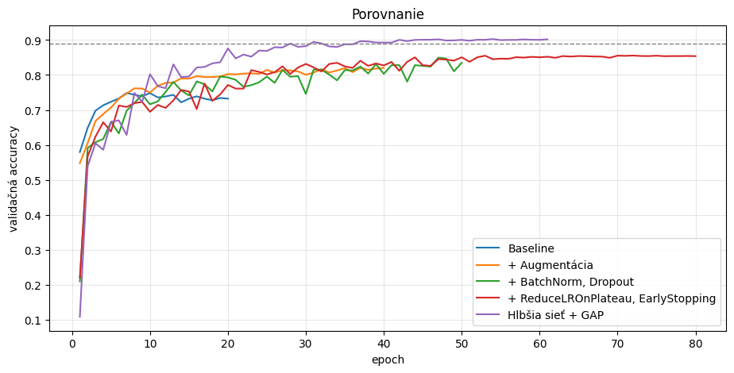
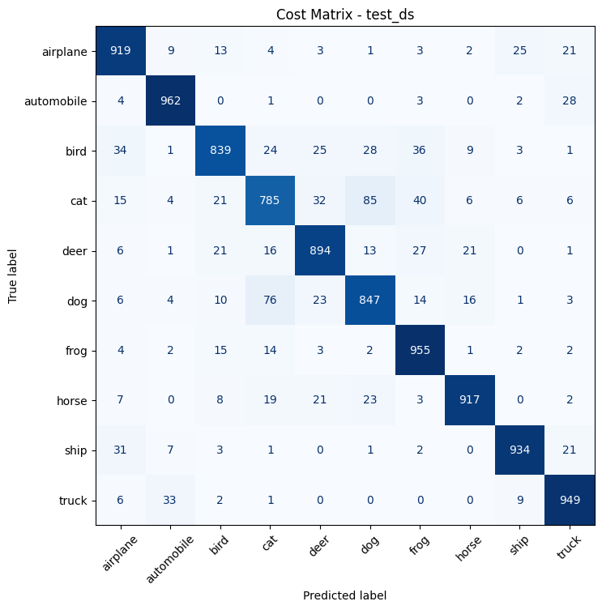

# CIFAR-10 CNN from scratch
 
Convolutional neural network in Keras/TensorFlow for image classification on CIFAR-10, built without pretrained models. The final model reaches **90.0 % test accuracy**.
 
[](https://colab.research.google.com/github/MartinSamas/cifar10_cnn/blob/main/cifar10_cnn_classification.ipynb)
 
## Data
CIFAR-10 from TensorFlow Datasets, split 40k / 10k / 10k (train / validation / test).
 
## Experiments

| Experiment | Params | Val acc | Val loss |
|---|---|---|---|
| Baseline (2 conv blocks + Dense) | 591k | 0.749 | 0.760 |
| + Data augmentation | 591k | 0.815 | 0.561 |
| + BatchNorm, Dropout | 593k | 0.850 | 0.439 |
| + ReduceLROnPlateau, EarlyStopping | 593k | 0.854 | 0.427 |
| Deeper network + GlobalAveragePooling | 1.15M | **0.901** | **0.308** |
 
- Augmentation removed most of the overfitting, BatchNorm and Dropout removed the rest.
- The LR schedule stabilized training and showed the smaller network had hit its capacity limit.
- A third conv block (64 → 128 → 256 filters) with GlobalAveragePooling pushed past it.

 
## Final model
3 conv blocks (Conv, BatchNorm, ReLU, *2 per block), MaxPooling and Dropout after each block, GlobalAveragePooling, softmax output. Trained with Adam, ReduceLROnPlateau and EarlyStopping.
 
**Test accuracy: 0.900**
 

  
## Run
Open the notebook in Colab with a GPU runtime. Google Drive cells are optional
 
```
pip install -r requirements.txt
```
 
## Authors
Martin Samaš, Martin Snížek. Assignment for 4IZ175
 
